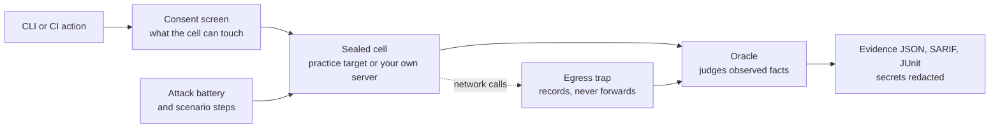

<p align="center">
  
</p>

<p align="center">
  <strong>The MCP red-team range.</strong><br>
  Break it here, so nobody breaks it out there.
</p>

<p align="center">
  <a href="LICENSE"></a>
  
  <a href="DISCLAIMER.md"></a>
  <a href="SECURITY.md"></a>
</p>

---

> [!CAUTION]
> **Read [`DISCLAIMER.md`](DISCLAIMER.md) before you clone, build or run anything.**
> Redfilade contains deliberately vulnerable code and attack code. Use it only against its own practice targets, or against systems you own or have written permission to test. **You alone are responsible for how you use it.** The maintainers and contributors accept no responsibility for any use or misuse, by anyone, anywhere. We also **cannot promise this repository has not been compromised**, so [verify it before you run it](#verify-before-you-run).

## What is Redfilade?

Redfilade is a free, source-available range for **learning and discovering attacks on Model Context Protocol (MCP)** servers and clients, the tools that AI agents call to read files, query databases and reach the web.

It works like a shooting range for MCP security:

- **Practice targets.** Every scenario ships two builds of the same MCP server: a **vulnerable twin** with a real flaw and a **secure twin** with the fix. You attack both.
- **A sealed cell.** Every target runs in a locked-down container with no access to your files, keys or network.
- **An impartial judge.** Redfilade decides what happened from facts it observes itself, such as a planted secret crossing the wire or a request reaching its trap server. It does not trust what the target says.
- **Evidence you can share.** Every run produces a JSON evidence record, SARIF for code scanning and JUnit for CI, with secrets redacted.

An attack discovered in the Range becomes a test that anyone can run against an MCP server **they own**.

> [!NOTE]
> **Redfilade is early (Phase 2).** The Range runs L1 and L2 attacks end to end with an egress trap, signed scenario packs and a review lane for contributed attacks. Hosted features are not built yet. See the [roadmap](#roadmap).

## Who it is for

| You are | Redfilade helps you |
|---|---|
| A student or self-learner | See real MCP attacks succeed and fail, safely, and read exactly why |
| A security researcher | Turn a new attack idea into a reproducible scenario with a vulnerable and a secure twin |
| A company or developer building an MCP server or client | Run the same attacks against your own server, in your own CI, before someone else does. Free, including for commercial companies, as long as it stays internal |
| A teacher or university | Run hands-on MCP security labs without exposing anything real |

Selling Redfilade, hosting it for others or building it into a product is not allowed. See [License and terms](#license-and-terms).

## Verify before you run

Redfilade is a security project, so it is a target for attackers too. We sign commits, protect `main`, pin every dependency, scan for secrets and sign releases, but we cannot guarantee that this repository, a fork or a download is clean. Before running it:

1. **Use the official repository only:** `https://github.com/redfilade/redfilade`.
2. **Check that commits show "Verified"** on GitHub, and verify release signatures and checksums with cosign as described in each release.
3. **Read and scan the code** with your own tools, especially scripts and anything that changed since you last looked.
4. **Run it in a throwaway virtual machine** with no personal data, credentials or SSH keys. Never expose practice targets to the internet.

Full checklist: [`DISCLAIMER.md`, section 6](DISCLAIMER.md#6-verify-before-you-run-we-cannot-promise-this-repository-is-safe).

## Try it

You need Docker and Go 1.26 or newer. Redfilade refuses to run a target without a container runtime, and it asks for your consent before every run.

```sh
go build -o redfilade ./cmd/redfilade
scripts/build-targets.sh                    # builds the practice targets as FROM-scratch images
./redfilade scenario list                   # the built-in scenarios
./redfilade range gate                      # attack every twin: vulnerable must fall, secure must hold
./redfilade range run l2-ssrf --build vulnerable
```

Test an MCP server **you own**, packaged as a container image:

```sh
./redfilade test --image my-mcp-server:dev --level L2 --sarif results.sarif
```

Or, for a Streamable HTTP server on your machine, or on a domain you have verified with `redfilade domain verify` (tokens are read from the environment variable you name):

```sh
./redfilade test --url http://127.0.0.1:8080/mcp --token-env MY_SERVER_TOKEN --level L2
./redfilade test --url https://api.example.com/mcp --token-env MY_SERVER_TOKEN --level L2
```

Test your **MCP client** against a hostile server, or score a **defence** (gateway or guardrail) on attacks stopped versus normal work broken:

```sh
./redfilade hostile-server --log /tmp/session.jsonl      # add to your client's MCP config, use it, then:
./redfilade client-report /tmp/session.jsonl
./redfilade defend --defence-image my-gateway-adapter:dev --min-block-rate 0.8 --max-false-positive-rate 0.05
```

Full guide: [`docs/range.md`](docs/range.md).

## Scenarios today

| Scenario | Level | What the attack shows |
|---|---|---|
| `l1-leaky-errors` | L1 | Error messages that leak stack traces, file paths and secrets |
| `l2-path-traversal` | L2 | A file tool tricked into reading outside its folder |
| `l2-ssrf` | L2 | A "fetch a preview" tool tricked into calling a server it should not reach |
| `l2-secrets-in-output` | L2 | A status tool that dumps its environment, API keys included |
| `l1-tool-poisoning` | L1 | A tool description that hides instructions to the AI model, detected with Cisco's MCP Scanner rules |
| `l2-command-injection` | L2 | A ping tool that pastes input into a shell command, so `;` and `$(...)` read a deploy key |
| `l4-hostile-server` | L4 | A malicious server hides instructions in invisible text, phishes for a password and abuses sampling against a client |
| `l3-inbox-injection` | L3 | An email asks the AI assistant to forward the inbox, including a reset code, to an outside address |
| `l2-sql-injection` | L2 | A customer lookup that pastes input into SQL, so a quote and `UNION` read an API key from another table |

Each one has a vulnerable twin, a secure twin and an automated check that the first is exploited and the second holds.

## Where Cisco comes in

Redfilade reuses one part of [Cisco's MCP Scanner](https://github.com/cisco-ai-defense/mcp-scanner): its **detection rules**. Nothing else.

| | |
|---|---|
| **What we use** | Cisco's 10 detection rules for malicious MCP text: tool poisoning, prompt injection, coercive injection, credential harvesting, data exfiltration, command, code, script and SQL injection, and system manipulation. Copied unmodified into [`internal/rules/cisco/`](internal/rules/cisco/) |
| **What they power** | The `tool_metadata_flagged` check (tool descriptions and parameters), the `output_injection_flagged` check (tool output), the L1 `l1-tool-poisoning` battery check and the `l1-tool-poisoning` practice scenario |
| **How they run** | Inside Redfilade's own Go engine ([`internal/rules`](internal/rules/)), tested to give exactly the same results as the official YARA engine on Cisco's test cases. Cisco's code never runs |
| **What you need** | **Nothing extra.** The rules are built into the `redfilade` binary. No Cisco account, API key, Python, YARA or internet connection is needed, and nothing is sent to Cisco |
| **What we do not use** | Cisco's scanner program, its cloud, AI-model and VirusTotal analysers, and its example malicious servers |
| **License** | The rules stay under the Apache License 2.0 with Cisco's copyright ([`LICENSE`](internal/rules/cisco/LICENSE), [`SOURCE.md`](internal/rules/cisco/SOURCE.md)). Cisco does not endorse Redfilade |
| **Updates** | Maintainers only: copy the new rules, refresh the checksums, regenerate the test corpus with [`scripts/cisco-rules-golden.py`](scripts/cisco-rules-golden.py) (needs `yara-python`), and review every change. See [ADR-0018](docs/adr/0018-reuse-cisco-mcp-scanner-rules.md) |

A rule match is a strong warning sign, not proof of intent: every report names the rule that fired and shows the matching text.

## Rules of engagement

1. **Attack only what you own or are explicitly authorised to test.** Remote servers can only be tested after you prove you control their domain, and the proof is checked again before every run.
2. **Practice targets are deliberately vulnerable.** Run them only inside Redfilade's isolation. Never expose them to the internet.
3. **Found a flaw in someone else's MCP server while testing with permission?** Report it privately to its maintainers and give them time to fix it before you publish.
4. **Found a flaw in Redfilade itself?** Use [private vulnerability reporting](SECURITY.md), never a public issue.
5. **Contributed attacks are hostile by design.** They run only in disposable, isolated cells, and only after a maintainer reviews them.

## How it works



Today a cell is a hardened container: no network or a private trap network, read-only filesystem, all privileges dropped, a non-root user and strict resource limits, with gVisor used automatically when it is installed. Disposable microVM cells are planned ([ADR-0001](docs/adr/0001-isolate-attack-runs-in-microvms.md)). Every report says which isolation ran and lists **what could not be observed**.

## Test levels

| Level | Checks | Status |
|---|---|---|
| **L1** Conformance and hygiene | Leaky errors, tool poisoning, then protocol correctness, schemas, auth, oversized inputs | Two checks available |
| **L2** Security battery | Path traversal, SSRF, secrets in output, command injection, SQL injection, and over HTTP: token audience, rate limits, routing-header mismatch | Eight attacks available |
| **L3** Agent in the loop | A real model uses the server while attacks arrive through descriptions and outputs | First scenario available: success rate with a 95% interval |
| **L4** Client and host | A client facing a hostile server: hidden text, password phishing, sampling abuse | Available: Range twins and your own client |
| **L5** Defence | A gateway or guardrail measured against every scenario and a benign task set | Available: block rate and false-positive rate with 95% intervals |

## Roadmap

- [ ] **Phase 0: Foundation.** Hardened organisation, pinned least-privilege CI, secret scanning, dependency policy, threat model, multi-tenant schema, a proven signed dry-run release. Done, including the signed `0.0.1` dry run; remaining org settings (rulesets, action allow-list, Renovate) in [`docs/phase-0.md`](docs/phase-0.md).
- [x] **Phase 1: Walking skeleton.** One attack against a vulnerable and a secure twin, judged by the oracle, with a signed report. [`docs/phase-1.md`](docs/phase-1.md)
- [x] **Phase 2: The real Range.** The L2 battery, signed scenario packs with a consent gate, and the triage lane for contributed attacks. [`docs/phase-2.md`](docs/phase-2.md)
- [x] **Phase 3: Hosted Test Bench.** HTTP transport and HTTP checks, domain verification and remote targets, L3 agent-in-the-loop, and the hosted service for remote tests ([`docs/bench.md`](docs/bench.md)). OAuth sign-in and hosted Range cells follow. Tracked in [`docs/phase-3.md`](docs/phase-3.md).
- [x] **Phase 4: Clients and defences.** L4 hostile server for testing MCP clients and hosts, and L5 measurement of gateways and guardrails against every scenario and a benign task set. Tracked in [`docs/phase-4.md`](docs/phase-4.md).

## Repository layout

```text
.github/            CI (untrusted lane), release (trusted lane), triage lane, CODEOWNERS, rulesets
assets/brand/       Banner, logo, mascot and social preview
cmd/redfilade/      CLI (Go)
cmd/redfilade-bench/ Hosted Test Bench service (Go)
internal/           MCP client, scenarios, world, sandbox, consent, oracle, detection rules, reports, battery, packs, triage
infra/sink/         Egress trap: records requests from cells, never forwards them
scenarios/          Built-in scenarios: data-only manifests (ADR-0013)
targets/            Vulnerable and secure twins, built into FROM-scratch images
action.yml          GitHub Action
db/migrations/      Multi-tenant Postgres schema with row-level security
docs/adr/           Architecture Decision Records 0001 to 0024
docs/threat-model/  STRIDE threat model
harness/            Attack harness and scenario SDK (Python)
```

## Supply-chain promises

- Every GitHub Action is pinned to a full commit SHA; workflow tokens are read-only by default.
- Pull requests from forks run in an untrusted lane with no secrets and no publishing rights.
- New dependency versions wait **7 days** before we install them, and install scripts are blocked.
- Releases come from one protected workflow, with **cosign signatures, an SBOM and build provenance**. No long-lived publishing tokens exist.

These reduce risk; they are not a guarantee. See [Verify before you run](#verify-before-you-run).

## Contributing

New attack ideas are especially welcome. Start with [`CONTRIBUTING.md`](CONTRIBUTING.md) and the [Code of Conduct](CODE_OF_CONDUCT.md). Contributed scenarios are reviewed by a maintainer and then tested in the isolated triage lane. Architectural changes begin as an ADR in [`docs/adr/`](docs/adr/).

## License and terms

Redfilade is **source-available** and free. You choose one of two licenses ([`LICENSE`](LICENSE)):

| You want to | License to use | Allowed |
|---|---|---|
| Learn, teach, research, write about attacks, share your own scenarios | [PolyForm Noncommercial 1.0.0](https://polyformproject.org/licenses/noncommercial/1.0.0) | Use, change and share, for noncommercial purposes |
| Test your own company's MCP servers and clients, including in CI | [PolyForm Internal Use 1.0.0](https://polyformproject.org/licenses/internal-use/1.0.0) | Use and change inside your organisation, including commercial companies; no distribution |

**Not allowed under either license:** selling Redfilade, offering it to others as a hosted or managed service, or building it into a product you distribute. No other license is offered. Because of these limits, Redfilade is not "open source" in the Open Source Initiative's sense.

- **Use:** only as allowed by [`DISCLAIMER.md`](DISCLAIMER.md), and only against systems you own or are authorised to test.
- **Responsibility:** yours alone. The software comes as is, with no warranty, and the licensor, maintainers and contributors accept no liability for any use or misuse.
- **Name and logo:** not licensed. See [`TRADEMARKS.md`](TRADEMARKS.md).

Versions published before this change remain under the Apache License 2.0 they were released with.

**Third-party code.** The detection rules in `internal/rules/cisco/` come from Cisco's MCP Scanner and remain under the Apache License 2.0. See [Where Cisco comes in](#where-cisco-comes-in).
