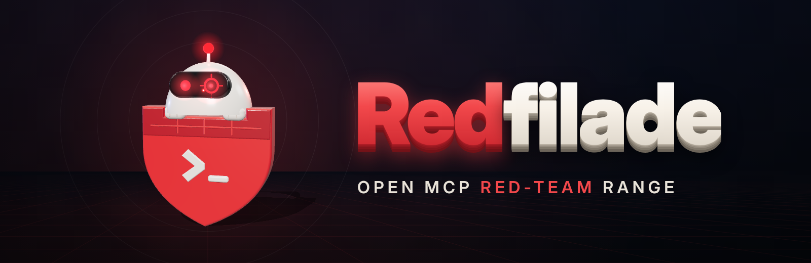
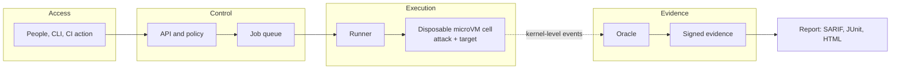

<p align="center">
  
</p>

<p align="center">
  <strong>Break it here, so nobody breaks it out there.</strong>
</p>

<p align="center">
  <a href="LICENSE"></a>
  
  <a href="SECURITY.md"></a>
</p>

---

Redfilade is an open platform for finding and fixing security flaws in **Model Context Protocol (MCP)** servers and clients, ethically and in the open.

It has two front doors on one engine:

- **The Range.** Deliberately weak MCP targets that anyone can attack, to learn and to discover new kinds of attack.
- **The Test Bench.** MCP builders point the same attacks at *their own* server or client and get a signed security report.

Both share one execution engine, one oracle and one evidence format. An attack discovered in the Range becomes a test that every builder can run the next day.

> [!IMPORTANT]
> **Redfilade is early (Phase 1).** The range runs, attacks and judges its first scenario end to end in hardened container cells. The battery is small, and hosted features are not built yet. See the [roadmap](#roadmap).

## Try it

```sh
go build -o redfilade ./cmd/redfilade
scripts/build-targets.sh        # needs Docker
./redfilade range gate          # every vulnerable twin must be exploited, every secure twin must hold
./redfilade test --image ghcr.io/you/your-mcp-server:dev --level L1 --sarif results.sarif
```

Full guide: [`docs/range.md`](docs/range.md).

## Rules of engagement

Redfilade exists to make MCP safer. Using it to harm systems you don't own is against everything the project stands for, and the platform is built to make it hard.

1. **Only test what you own or are explicitly authorised to test.** Remote targets must pass domain-ownership verification before a single request is sent.
2. **Range targets are deliberately vulnerable.** Run them only inside Redfilade's isolation. Never expose them to the internet.
3. **Found a flaw in someone else's MCP server?** Report it privately to its maintainers and give them reasonable time to fix it before you publish.
4. **Found a flaw in Redfilade itself?** Use [private vulnerability reporting](SECURITY.md), never a public issue or discussion.
5. **Contributed attacks are hostile by design.** They run only in disposable, isolated cells, never on a maintainer's or user's own machine.

## How it works

The platform is split into four planes. Each has one job, so a fully compromised run cell can reach neither the keys in the control plane nor the verdicts in the evidence plane.



The Range and the Test Bench differ only in what sits in the target slot: one of our deliberately weak targets, or the builder's own server or client.

## Ways to test

| Way in | For | Example | What leaves your machine |
|---|---|---|---|
| Local CLI (available) | Solo developers, open-source maintainers | `redfilade test --image my-server:dev --level L1` | Nothing |
| CI action (available) | Teams shipping on GitHub | `uses: redfilade/redfilade@<commit-sha>` | Nothing beyond your CI runner |
| Hosted, remote URL (planned) | Companies with a remote MCP endpoint | Verify your domain once, then schedule tests | Test traffic to your own verified domain |
| Client test (planned) | IDE, agent and desktop-app makers | Point your client at our hostile test servers | Only what your client sends to them |
| Self-hosted (planned) | Regulated enterprises | Helm chart in your own cluster, air-gapped signing | Nothing |

## Test levels

| Level | Checks | Verdict |
|---|---|---|
| **L1** Conformance and hygiene (first attack available) | Protocol correctness, schemas, auth required, leaky errors, oversized inputs | Strong for what it covers |
| **L2** Security battery | Injection, path traversal, SSRF, token audience, rate limits, secrets in outputs | Strong when side effects are observable |
| **L3** Agent-in-the-loop | A real model uses your server while attacks arrive through descriptions, outputs and other servers | A success rate with a 95% interval |
| **L4** Client and host | Your client facing hostile servers: hidden text, sampling abuse, approval tricks | Strong: we control the hostile side |
| **L5** Defence | Your gateway or guardrail measured against every scenario and a benign task set | Paired result, with false-positive rate |

Every report states which level ran, the verdict per scenario, **what could not be observed**, and how to verify its signature.

## Roadmap

- [ ] **Phase 0: Foundation.** Hardened organisation, rulesets, pinned and least-privilege CI, secret scanning, dependency policy, threat model, ADR-001 to ADR-012, multi-tenant schema, a proven signed dry-run release. Tracked in [`docs/phase-0.md`](docs/phase-0.md).
- [ ] **Phase 1: Walking skeleton.** `redfilade test --level L1` runs one attack against a vulnerable and a secure twin, the oracle observes it, and a signed SARIF report comes out. Built; the signed proof runs in the release workflow. Tracked in [`docs/phase-1.md`](docs/phase-1.md).
- [ ] **Phase 2: The real Range.** The L2 battery, signed scenario packs with a consent gate, and the triage lane for contributed attacks.
- [ ] **Phase 3: Hosted Test Bench.** Domain verification, remote targets and L3 agent-in-the-loop testing.

## Repository layout

```text
.github/            CI (untrusted lane), release (trusted lane), CODEOWNERS, ruleset
assets/brand/       Logo (3D renders and flat vectors) and the scripts that build them
cmd/redfilade/      CLI (Go)
internal/           MCP client, scenarios, world, sandbox, consent, oracle, reports, battery
scenarios/          Range scenarios: data-only manifests (ADR-0013)
targets/            Vulnerable and secure twins, built into FROM-scratch images
action.yml          GitHub Action for builders
db/migrations/      Multi-tenant Postgres schema with row-level security
docs/adr/           Architecture Decision Records 001 to 012
docs/threat-model/  STRIDE threat model of the four planes
harness/            Attack harness and scenario SDK (Python)
```

## Supply-chain promises

Redfilade will be run inside other people's CI, so it is a target. We hold ourselves to these rules from the first commit:

- Every GitHub Action is pinned to a full commit SHA; the default workflow token is read-only.
- Pull requests from forks run in an untrusted lane with no secrets and no publishing rights.
- New dependency versions wait **7 days** before we install them; install scripts are blocked.
- Releases come from one protected workflow, on signed tags only, with **cosign signatures, an SBOM and build provenance**. No long-lived publishing tokens exist.

## Contributing

Contributions are welcome, especially new attack ideas. Start with [`CONTRIBUTING.md`](CONTRIBUTING.md) and the [Code of Conduct](CODE_OF_CONDUCT.md). Architectural changes begin as an ADR in [`docs/adr/`](docs/adr/).

## License

Redfilade is licensed under the [Apache License 2.0](LICENSE). The Redfilade name and logo are not covered by that licence (see section 6 of it): please don't use them in a way that suggests endorsement.
