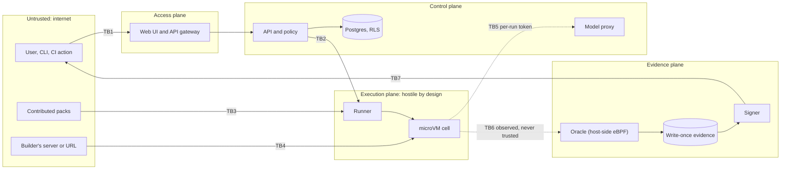

# Threat model v0

- **Status:** Draft v0, written before feature code (Phase 0)
- **Date:** 2026-11-14
- **Method:** Draw the data flows, mark trust boundaries, apply STRIDE to every flow that crosses one, then assume each component is malicious and ask what it could reach.

This is a living document. Every feature pull request that adds a data flow or crosses a trust boundary updates it.

## System and trust boundaries

| Boundary | What crosses it | Why it matters |
|---|---|---|
| TB1 | Requests from users, the CLI and CI | Identity and tenant are established here |
| TB2 | Jobs from the control plane to runners | Runners must never hold control-plane credentials |
| TB3 | Contributed scenario packs | Hostile by design (architecture record 10.3) |
| TB4 | Builder-supplied images, commands and URLs | Code we did not write, treated like our weakest target |
| TB5 | Model calls from inside a cell | The most valuable secret sits on the other side |
| TB6 | Events observed from a cell | Everything inside a cell may lie |
| TB7 | Signed reports leaving the platform | Rendered by other tools; must be inert |

## STRIDE by plane

### Access plane: web UI, API gateway, CLI and CI entry

| Threat | Example | Control |
|---|---|---|
| **S**poofing | Stolen session or OAuth token used to act as a user | GitHub OAuth and SSO only (ADR-009), short sessions, no passwords stored |
| **T**ampering | Request altered to switch `org_id` to another tenant | Tenant derived from the session, never from the request body; RLS as the backstop |
| **R**epudiation | "I never started that remote test" | Append-only audit log of logins, runs, remote targets and admin actions |
| **I**nformation disclosure | Cross-site scripting through evidence text shown in the dashboard | Evidence rendered as inert text, strict CSP, rich previews only in a sandboxed iframe on a separate domain |
| **D**enial of service | Floods of run requests | Per-tenant quotas and rate limits |
| **E**levation of privilege | A viewer triggers an admin action | Roles checked on the server for every action (owner, admin, tester, viewer) |

### Control plane: API, policy, database, job queue, model proxy

| Threat | Example | Control |
|---|---|---|
| **S** | A compromised runner calls the API as the control plane | Runners get narrowly scoped, short-lived credentials that cannot call admin APIs |
| **T** | Job parameters edited in the queue to target an unverified domain | Policy re-checked when the job is claimed; verified-domain allowlist enforced in the network (ADR-010) |
| **R** | Admin changes a tenant's settings without trace | Admin actions audit-logged to a separate account |
| **I** | One tenant reads another's results | Postgres RLS forced on every tenant table, composite foreign keys, tested in `db/tests/tenancy_test.sql` |
| **I** | Model provider keys stolen | Keys live only in the model proxy; cells get per-run tokens (ADR-008) |
| **D** | A tenant exhausts the model budget | Hard spend caps per run and per tenant |
| **E** | SQL injection reaches rows outside the tenant | Parameterised queries only; the app role has no `BYPASSRLS` |

### Execution plane: runners and microVM cells

| Threat | Example | Control |
|---|---|---|
| **S** | A pack pretends to be a signed, reviewed pack | The CLI and runner verify maintainer signatures before running (architecture record 10.3) |
| **T** | A run modifies the host or the next run's cell | Disposable microVM per run, read-only root filesystem (ADR-001) |
| **R** | A builder denies uploading an escape kit | Every image and command recorded with the requesting account |
| **I** | A cell reads host files, cloud metadata or other cells' traffic | No host mounts, metadata endpoint blocked, default-deny egress, per-tenant namespaces |
| **D** | Crypto miner or fork bomb disguised as a server | CPU, memory, process and time caps per cell |
| **E** | Kernel exploit from inside the cell | Separate guest kernel (Kata and Firecracker); gVisor on laptops; escape-class packs refuse plain Docker |

### Evidence plane: oracle, evidence store, signer, reports

| Threat | Example | Control |
|---|---|---|
| **S** | Forged report that claims to come from Redfilade | Keyless Sigstore signatures, verified against the release workflow's identity (ADR-007) |
| **T** | Evidence edited after the run | Object Lock write-once storage, signed bundles, transparency log (ADR-004, ADR-007) |
| **R** | "The oracle never saw that" | Host-side eBPF events stored with the bundle (ADR-006) |
| **I** | Secrets from the builder's test config appear in reports | Reports scrubbed for secret patterns before SARIF or HTML is written; canary tokens detect leaks |
| **D** | Huge outputs exhaust storage | Size limits per artifact and per run |
| **E** | Injection through SARIF or JUnit text into GitHub or CI dashboards | All report text escaped; raw tool output never in titles or messages (ADR-011) |

## Local range runner (Phase 1)

New flows added by the CLI's range runner (ADR-0013 to ADR-0015). The CLI is the trusted side; everything in the cell is hostile.

| Flow | Threat | Control |
|---|---|---|
| Manifest → CLI | A crafted `scenario.json` exhausts memory or smuggles fields | Size-capped read, strict decoding with unknown fields rejected, bounded lists and lengths |
| Manifest → consent screen | Author-written text tricks the user into saying yes | The screen is built only from validated structured fields; free text is not shown |
| CLI → cell | Cell reaches the host: files, keys, Docker socket, network | Hardened `docker run`: no host mounts but the run's world, read-only root, `--cap-drop ALL`, `no-new-privileges`, non-root, `--network none`, empty environment, resource limits. Unit tests assert these flags |
| Cell → CLI (stdio) | Oversized or endless output, malformed JSON, fake results | Per-message size cap, request timeouts, total run deadline; replies are data and never executed |
| Cell → oracle | Target claims "secure" or hides its effects | Verdicts come from observed facts only (wire frames, world-file hashes); anything not observable is listed as such |
| Evidence → reports | Tool output injects markup into SARIF/JUnit/HTML viewers | All text escaped, control characters stripped, length-capped; canaries redacted; raw output never in titles |
| World dir | Canaries leak into logs before the run ends | Canaries live only in the run record and the world dir; logs print redacted values |

## Egress sink, packs and triage (Phase 2)

New flows from ADR-0016 and the egress sink.

| Flow | Threat | Control |
|---|---|---|
| Cell → sink | Target reaches the internet or the host through the sink network | Per-run `--internal` Docker network with no route out; the sink only records requests and never forwards them |
| Sink log → oracle | Crafted requests flood or poison the log | The sink logs at most 500 requests with bodies capped at 8 KB and fields truncated; the host reads at most 2 MB of the log as data; request text is redacted and escaped like any other evidence |
| Pack → CLI | Tampered or look-alike pack presented as ours | Identity is the sha256 of the exact bytes; "verified" needs a cosign bundle for `release.yml` on main or a version tag; invalid signatures are always refused |
| Pack → consent | User approves an unsigned pack without noticing | Policy runs first: unsigned needs `--allow-unsigned` plus the typed id, and CI needs the exact digest; the screen shows source and signature state |
| Pull request → triage runner | Contributor code runs on the runner or steals a token | Only the base commit is built; the PR is checked out as data and only regular `scenario.json` files are copied; label-gated, no secrets, no OIDC, read-only token, no `pull_request_target` |
| Triage evidence → job summary | Hostile text renders as Markdown/HTML for maintainers | The trusted CLI prints only allow-listed ids, verdicts, builds and fact names; everything else becomes a fixed placeholder |
| Server text → detection rules | Crafted descriptions or output stall the oracle (regex backtracking) or flood it | Rules run on Go's RE2 engine (linear time); 64 KiB per field and 1 MiB per run, reported when reached; the rule parser refuses unsupported syntax |
| Third-party rules → oracle | A changed upstream rule silently weakens or breaks detection | Rules copied unmodified at a pinned commit with SHA-256 sums; the golden corpus must match the reference engine exactly; CODEOWNERS review on `internal/rules/` |
| CLI → remote target (HTTP) | Redfilade is pointed at someone else's server | `--url` accepts loopback hosts only until domain verification; only remote-safe, read-only attacks run; request budget shown before consent |
| Remote target → CLI (HTTP) | Redirects to internal addresses, oversized or endless responses, hostile headers | Redirects never followed; bodies and SSE streams size-limited; header values cleaned before reports |
| CLI → evidence (HTTP) | The builder's bearer token leaks into evidence or logs | Tokens read from named environment variables only, redacted from frames and errors |
| Pack → image | Pack names an attacker image from a registry | Range runs use `--pull never`: only locally built twins can run |

## The project's own supply chain

Redfilade will run inside other people's CI, which makes this repository a target in its own right.

| Threat | Control in this repository |
|---|---|
| Poisoned dependency runs code on install | pnpm `strictDepBuilds` and `onlyBuiltDependencies: []`; `ignore-scripts` in `.npmrc` |
| Freshly hijacked package version | 7-day cooldown: pnpm `minimumReleaseAge`, uv `exclude-newer`, Renovate `minimumReleaseAge` |
| Compromised GitHub Action | Every action pinned to a full commit SHA; org policy allow-lists actions |
| Fork pull request steals secrets or publishes | Untrusted lane (`ci.yml`): no secrets, no OIDC, read-only token, `persist-credentials: false` |
| Release workflow runs attacker code | `release.yml` runs only on tags or from main, verifies the commit is on main, needs environment approval |
| Secret committed by mistake | Push protection, gitleaks pre-commit hook and CI history scan |
| Maintainer account takeover | Org-wide secure 2FA, rulesets with no bypass on integrity rules, tag creation limited to owners |

## Known gaps in v0

- The control plane, runner and oracle do not exist yet. Their controls above are design commitments, verified as each lands.
- `redfilade.users` is not tenant-scoped: an app bug could list user identities across orgs. Revisit when the API is built.
- `step-security/harden-runner` runs in audit mode. Switch to `block` with an endpoint allowlist after baseline runs (`docs/phase-0.md`).
- No external review yet. An independent penetration test is planned before the hosted Test Bench opens.
